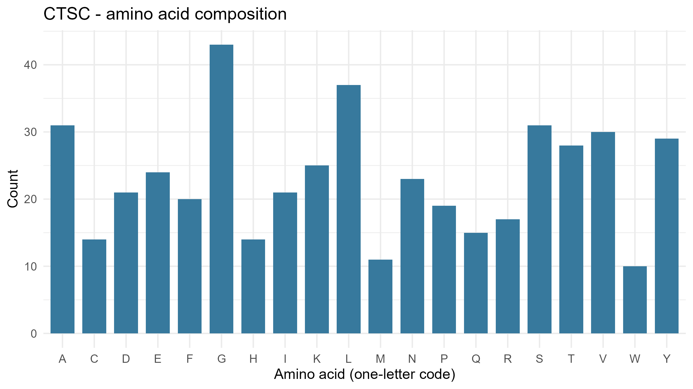
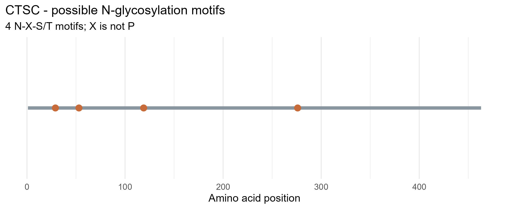

# Lysosomal Enzyme Sequence Analysis – CTSC

## 1. Gene and Enzyme Information

- *Gene Symbol:* CTSC
- *Enzyme Name:* Cathepsin C
- *Alternative Name:* Dipeptidyl Peptidase I (DPPI)
- *Organism:* Homo sapiens
- *Enzyme Classification:* Lysosomal cysteine protease
- *NCBI Protein Accession:* NP_001805.4
- *Protein Length:* 463 amino acids

### NCBI Protein Record

https://www.ncbi.nlm.nih.gov/protein/NP_001805.4

## 2. Enzyme Function

Cathepsin C is a lysosomal cysteine protease involved in the breakdown and processing of proteins and peptides. It removes dipeptides from the N-terminal ends of polypeptide chains. It also plays an important role in activating certain serine proteases found in immune cells, including neutrophils and cytotoxic lymphocytes.

## 3. Sequence Analysis

The human CTSC protein sequence was obtained from the NCBI Protein database and analyzed using R. The analysis determined the protein length, amino acid composition, and potential N-glycosylation motifs.

### 3.1 Amino Acid Composition

The CTSC protein contains 463 amino acids. The five most abundant amino acids identified in the sequence are presented below.

| Amino Acid | Count | Percentage |
|---|---:|---:|
| Glycine (G) | 43 | 9.29% |
| Leucine (L) | 37 | 7.99% |
| Alanine (A) | 31 | 6.70% |
| Serine (S) | 31 | 6.70% |
| Valine (V) | 30 | 6.48% |

Glycine was the most abundant amino acid, accounting for 9.29% of the protein sequence, followed by leucine at 7.99%. Alanine and serine each represented 6.70%, while valine accounted for 6.48%.

### 3.2 Potential N-Glycosylation Motifs

Four potential N-glycosylation motifs were identified in the CTSC sequence using the N-X-S/T pattern, where X represents any standard amino acid except proline.

| Position | Motif |
|---|---|
| 29 | NCT |
| 53 | NCS |
| 119 | NET |
| 276 | NNS |

These motifs represent possible N-glycosylation sites based on the amino acid sequence. Their presence does not confirm that the protein is glycosylated at these positions.

## 4. Results and Figures

### Figure 1. Amino Acid Composition of CTSC

*Figure 1.* Distribution of the 20 standard amino acids in the human CTSC protein sequence. Glycine had the highest frequency, followed by leucine, alanine, serine, and valine.

### Figure 2. Potential N-Glycosylation Motifs in CTSC

*Figure 2.* Positions of the four potential N-glycosylation motifs along the 463-amino-acid CTSC sequence. The identified motifs occur at positions 29, 53, 119, and 276.

## 5. Laboratory Guide Questions

### 1. What does your enzyme normally break down inside lysosomes?

Cathepsin C breaks down proteins and peptides by removing two amino acids at a time from their N-terminal ends. This activity contributes to protein processing and degradation inside lysosomes. It is also important for activating certain serine proteases involved in immune cell functions.

### 2. What is the total length of your protein, and which amino acids are most common?

The CTSC protein consists of 463 amino acids. Based on the R analysis, glycine was the most abundant, with 43 residues (9.29%), followed by leucine with 37 (7.99%). Alanine and serine each had 31 residues (6.70%), while valine had 30 residues (6.48%).

### 3. How many potential N-glycosylation motifs did you find? Where are they located?

Four potential N-glycosylation motifs were identified in the CTSC protein sequence. These were NCT at position 29, NCS at position 53, NET at position 119, and NNS at position 276. All four follow the N-X-S/T sequence pattern, where X is not proline.

### 4. Why can glycosylation matter for lysosomal proteins? Does finding a motif prove the protein is glycosylated?

Glycosylation is important for the proper folding, stability, and transport of many lysosomal proteins. In many lysosomal enzymes, N-linked glycans can be modified with mannose-6-phosphate, which helps direct the enzymes toward lysosomes. However, identifying an N-X-S/T motif does not prove that glycosylation occurs at that site. Further experimental evidence is needed to confirm the modification.

### 5. What could happen in the cell if your enzyme did not work properly?

If Cathepsin C does not function properly, the processing and activation of certain immune cell proteases may be impaired. This can affect normal immune cell functions and protein processing. CTSC deficiency is associated with Papillon-Lefèvre syndrome, a genetic disorder characterized by thickening of the skin on the palms and soles and severe periodontal disease that may lead to early tooth loss. This highlights the importance of Cathepsin C in maintaining normal cellular functions.

## 6. Project Files

The repository contains the following files:

### Data
- data/CTSC.fasta

### Results
- results/CTSC_summary.csv
- results/CTSC_amino_acid_counts.csv
- results/CTSC_motif_positions.csv

### Figures
- figures/CTSC_amino_acid_composition.png
- figures/CTSC_potential_N_glycosylation.png

### R Script
- lysosomal_enzyme_analysis.R

## 7. Conclusion
The sequence analysis of Cathepsin C (CTSC) identified a protein consisting of 463 amino acids, with glycine as the most abundant amino acid. Four potential N-glycosylation motifs were detected at positions 29, 53, 119, and 276. These findings provide information about the protein's amino acid composition and possible glycosylation sites, although the presence of these motifs does not confirm actual glycosylation. Overall, the activity demonstrated how NCBI and R can be used to analyze protein sequences and better understand the structural characteristics of lysosomal enzymes.

## 8. References

National Center for Biotechnology Information. (n.d.). CTSC cathepsin C [Homo sapiens (human)]. NCBI Gene. https://www.ncbi.nlm.nih.gov/gene/1075

National Center for Biotechnology Information. (n.d.). Dipeptidyl peptidase 1 isoform a preproprotein [Homo sapiens] (NP_001805.4). NCBI Protein. https://www.ncbi.nlm.nih.gov/protein/NP_001805.4

Pohl, S., Marschner, K., Storch, S., & Braulke, T. (2009). Glycosylation- and phosphorylation-dependent intracellular transport of lysosomal hydrolases. *Biological Chemistry, 390*(7), 521–527. https://www.degruyterbrill.com/document/doi/10.1515/BC.2009.076/html#APA

Pham, C. T. N., Ivanovich, J. L., Raptis, S. Z., Zehnbauer, B., & Ley, T. J. (2004). Papillon-Lefèvre syndrome: Correlating the molecular, cellular, and clinical consequences of cathepsin C/dipeptidyl peptidase I deficiency in humans. *The Journal of Immunology, 173*(12), 7277–7281. https://academic.oup.com/jimmunol/article-abstract/173/12/7277/8035586?redirectedFrom=fulltext
